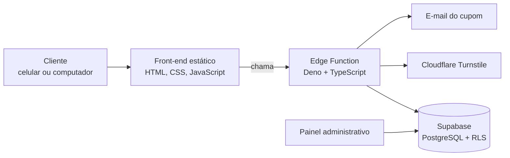

# Roleta da Sorte

Promoção online em que o cliente informa seus dados, gira a roleta e ganha um cupom de desconto (ou cai na fatia "não ganhou"). Funciona em celular, tablet e computador.

**Site no ar:** https://roleta-lebes.vercel.app

> **Estudo de caso.** O código é de uso interno de uma empresa e fica em um repositório privado. Aqui estão o problema, a arquitetura e as decisões técnicas.

## O problema

Uma promoção com sorteio na internet precisa ser divertida para quem joga e difícil de burlar para quem organiza. O sorteio não pode ser decidido no navegador, os dados do cliente precisam ser válidos e protegidos, e o time precisa acompanhar o volume e validar o cupom no caixa.

## O que o sistema faz

- **Roleta animada** em SVG, com confete no resultado e layout pensado para o celular.
- **Sorteio no servidor.** O navegador só anima o resultado que o banco já decidiu, então não dá para manipular o prêmio pela tela.
- **Validação dos dados.** CPF, e-mail, celular, data de nascimento e gênero são conferidos no navegador e de novo no servidor.
- **Proteção contra robôs.** Captcha (Cloudflare Turnstile) antes de girar.
- **Cupom por e-mail**, com controle de envio por participação.
- **Resgate no caixa.** O cupom é validado e baixado uma única vez.
- **Painel administrativo** em projeto separado: login com segundo fator, visão geral, participações, validação de cupom, auditoria e gestão da equipe por papéis.
- **Alerta de volume.** Um alarme avisa por e-mail quando a quantidade de participações foge do normal.
- **Privacidade.** Termos de uso e consentimento versionados, pensados para a LGPD.

## Arquitetura

| Parte | Tecnologia |
| --- | --- |
| Front-end | HTML, CSS e JavaScript puros, hospedados na Vercel |
| API | Supabase Edge Function (Deno + TypeScript) |
| Banco | PostgreSQL no Supabase, com Row Level Security e funções para girar a roleta e resgatar o cupom |
| Agendamento | `pg_cron` para o alarme de volume |
| Segurança | Turnstile, cabeçalhos de segurança, RLS, segundo fator no painel, trilha de auditoria |
| Testes | Servidor de simulação local e testes de ponta a ponta com Chrome headless |

## Decisões que valem destacar

- **A regra do jogo mora no banco.** As funções `girar_roleta()` e `resgatar_cupom()` concentram sorteio e baixa, o que evita corrida e uso duplicado.
- **Autorização no banco, não na tela.** O painel administrativo só mostra o que as políticas RLS permitem.
- **Testável sem infraestrutura.** Um servidor de simulação reproduz a API, então o fluxo inteiro roda localmente sem Supabase nem captcha.
- **Migrações versionadas.** Cada mudança de banco é um arquivo, na ordem em que aconteceu.

## Minha parte

Construí o sistema de ponta a ponta: modelagem do banco, funções SQL, Edge Function, front-end, painel administrativo, testes e publicação.

## Tecnologias

TypeScript · Deno · Supabase · PostgreSQL · Row Level Security · pg_cron · JavaScript · Cloudflare Turnstile · Vercel

## Contato

Pedro Rodrigues da Cunha · [LinkedIn](https://www.linkedin.com/in/pedrorodrigues2) · [GitHub](https://github.com/rodriguespedro22)
